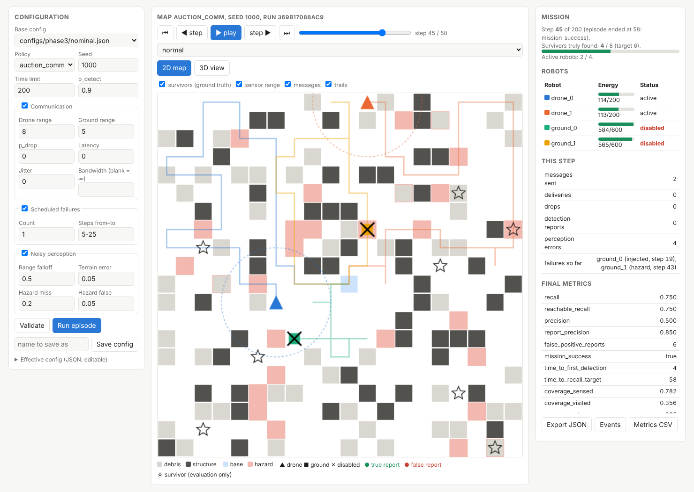

# SWARM

**Autonomous Multi-Agent Disaster Response and Search & Rescue Intelligence.** SWARM is a research
platform for studying how simulated drones and ground robots search a disaster area, share
uncertain information, divide work and learn to cooperate. It is a simulator for research. It does
not control real aircraft or robots, and it is not validated for real disaster operations.

SWARM simulates heterogeneous teams of drones and ground robots searching a 2D disaster area for
survivors under hazards, noisy sensing, battery limits, a lossy communication channel and robot
failures. Its main features:
- classical, coordinated and learned (MARL) policies;
- pre-registered experiments with archived, reproducible results;
- a web dashboard and a kinematic 3D view.



## Quick start

Python 3.12–3.14. The core needs only NumPy.

```bash
git clone https://github.com/Exit0Hero/SWARM.git && cd SWARM
python -m venv .venv
source .venv/bin/activate            # Windows PowerShell: .venv\Scripts\Activate.ps1
python -m pip install -e .
swarm demo                           # two scenarios, exports, a policy comparison (~5 s)
swarm dashboard --data-dir swarm-demo/dashboard    # open http://127.0.0.1:8765/
```

To see the 3D view, install `pip install -e ".[sim3d]"` and rerun `swarm demo`. In the dashboard,
press "3D view". It is a kinematic view of the 2D episode, **not a flight simulation**.

More:
- [Public website and Vercel deployment](docs/29_WEB_DEPLOYMENT.md): replays real recorded runs; nothing runs on the server
- [Installation and CLI guide](docs/26_INSTALL_AND_CLI.md)
- [Reproducibility guide](docs/27_REPRODUCIBILITY.md)
- [Benchmarks](docs/28_BENCHMARKS.md)
- [Complete platform status](docs/25_COMPLETE_PLATFORM_STATUS.md)

## What SWARM includes (v0.1.0)

| Area | Status | Docs |
|---|---|---|
| Deterministic 2D simulator: two layers, energy, hazards, noisy detection, events | Stable, tested | [04](docs/04_SIMULATION_SPECIFICATION.md), ADR-0001–0013 |
| Classical baselines: A*, frontier, assignment, oracle reference | Stable, tested. Validated (docs/16–17) | [16](docs/16_PHASE2_BASELINE_STUDY.md) |
| Limited-communication coordination: channel, shared belief maps, lease auction, failure detection and reassignment | Stable, tested. Validated (docs/18, docs/20) | [18](docs/18_PHASE3_COORDINATION_STUDY.md) |
| MARL sector allocation: IPPO/MAPPO, nine trained models | Stable, tested. Validated at a small CPU budget (docs/19) | [19](docs/19_PHASE4_MARL_STUDY.md) |
| Perception model: range falloff, terrain and hazard misreads, report confidence | Tested. Benchmark is exploratory | [22](docs/22_PERCEPTION.md) |
| Web dashboard: replay, robots, communication, failures, experiments, history, exports | Tested (unit, HTTP, clean-install smoke) | [23](docs/23_DASHBOARD.md) |
| 3D: kinematic co-simulation in MuJoCo, line of sight, 3D view | Tested. **Partial**: no flight dynamics | [24](docs/24_3D_SIMULATION.md) |
| `swarm` CLI and packaged examples | Tested | [26](docs/26_INSTALL_AND_CLI.md) |

**Not included:**
- flight dynamics;
- 3D-aware policies or sensing;
- an image-based detector;
- any validation for real operations.

See [limitations](docs/25_COMPLETE_PLATFORM_STATUS.md#12-partially-completed-and-deferred) and
[`docs/15_RISK_REGISTER_AND_LIMITATIONS.md`](docs/15_RISK_REGISTER_AND_LIMITATIONS.md).

Development history: the phase-by-phase record is in [`docs/14_ROADMAP.md`](docs/14_ROADMAP.md),
and released changes are in [`CHANGELOG.md`](CHANGELOG.md).

**Policies** (`swarm policies` lists them; `swarm run --policy <name>`):

| Policy | Information model |
|---|---|
| `random_valid` | decentralized (sanity baseline) |
| `astar_waypoint`, `frontier`, `frontier_hazard_aware` | decentralized (own observations only) |
| `prioritized_frontier`, `assignment`, `assignment_hazard_aware` | centralized_pooled (all agents' observations; perfect communication assumed) |
| `assignment_oracle` | **oracle** (reads hidden survivor locations; reference only, never reported as non-oracle performance) |
| `frontier_shared`, `auction_comm`, `auction_no_reassign` | decentralized with communication (belief records, claims, heartbeats) |
| `learned:<model>` | decentralized learned sector selection (Phase 4 actors; NumPy inference) |

All results are simulation results on synthetic maps with illustrative parameters. All agents move one cell per
step, so nothing here shows that drones outperform ground robots, or the reverse. Hazards and false reports are simple
probabilistic models. The simulator is a simplified abstraction, not a realistic model
(see `docs/15_RISK_REGISTER_AND_LIMITATIONS.md`). Phases and acceptance criteria are in `docs/14_ROADMAP.md`.

## Run an episode

```bash
swarm run --config basic --policy auction_comm --seed 1000 --out runs/basic.json --events runs/basic.jsonl
# equivalent long form, with an ASCII map:
python -m swarm.experiments.run_episode --config configs/m2_default.json --seed 0 \
    --out runs/m2_seed0.json --events runs/m2_seed0.events.jsonl --render
```

This writes a versioned JSON result (config, seed derivation, software versions, git commit, metric values with
definitions and units, and event-stream hash) and prints a summary. Re-running with the same config and seed
reproduces the same `event_stream_sha256` and metrics. `configs/m1_default.json` is the M1 scenario: a schema-v1
file that still loads and reproduces its M1 results exactly.

## Run the baseline study

```bash
python -m swarm.experiments.run_baselines --config configs/m2_default.json --seeds 0-49 \
    --out-dir runs/phase2/m2
```

This runs every registered policy on identical seeds, writes one experiment JSON per policy, the pre-registered paired
comparisons, and generated summary tables.

## Run a multi-seed experiment

```bash
python -m swarm.experiments.run_experiment --config configs/m2_default.json \
    --policy random_valid --seeds 0-29 --out runs/m2_random.json
```

This reports n, mean, sample standard deviation and a 95% percentile-bootstrap interval per metric, plus counts of
failed episodes and undefined values. Formats are in `docs/11_REPRODUCIBILITY_AND_EXPERIMENT_LOGGING.md`; metric
definitions are in `docs/decisions/0009-mission-objectives-and-metrics.md`.

## Install (development)

Requires Python 3.12 or newer. Full instructions, including Windows PowerShell, are in
[`docs/26_INSTALL_AND_CLI.md`](docs/26_INSTALL_AND_CLI.md).

```bash
python -m venv .venv
source .venv/bin/activate          # Windows PowerShell: .venv\Scripts\Activate.ps1
python -m pip install -e ".[dev]"
```

Optional extras:
- `.[viz]`: matplotlib, for the replay viewer and study figures.
- `.[learning]`: PyTorch, PettingZoo and Gymnasium, for MARL training (Phase 4). For CPU-only
  PyTorch, first run `pip install torch --index-url https://download.pytorch.org/whl/cpu`.
  Evaluating a trained policy needs only NumPy.
- `.[sim3d]`: MuJoCo, for the 3D co-simulation analysis (Phase 8). The dashboard's 3D view works
  without it.
- The dashboard needs no extra.

## Quality gate

CI runs these on Python 3.12, 3.13 and 3.14, plus a learning job and a MuJoCo job. It also builds
the wheel, installs it into a clean environment and runs `scripts/smoke_test.py` on Linux, macOS
and Windows. Contributor workflow: [`CONTRIBUTING.md`](CONTRIBUTING.md). Security:
[`SECURITY.md`](SECURITY.md).

```bash
ruff check .
ruff format --check .
mypy
pytest
```

## Python support

`requires-python >=3.12`. CI tests Python 3.12, 3.13 and 3.14 on Linux, plus a clean wheel install
on Linux (3.12, 3.14), macOS (3.13) and Windows (3.13). The runtime dependency is NumPy only. PyTorch,
PettingZoo, Gymnasium, matplotlib and MuJoCo are optional extras.

## Repository layout

| Path | Purpose |
|---|---|
| `CLAUDE.md` | Standing instructions for Claude Code |
| `MASTER_PROMPT.md` | Project brief |
| `docs/` | Requirements, specifications, roadmap, risks (numbered 01–15) |
| `docs/decisions/` | Architecture Decision Records |
| `.claude/skills/` | Project-specific Claude Code skills |
| `src/swarm/` | Python package: `core`, `scenarios`, `navigation`, `coordination`, `policies`, `learning`, `evaluation`, `experiments`, `dashboard`, `visualization`, `sim3d`, `examples`, `cli` |
| `scripts/smoke_test.py` | End-to-end smoke test of an installed package (used by CI) |
| `docs/results/` | Archived generated results of pre-registered studies |
| `configs/` | Scenario configs and study specs for every phase (`m1_default.json` schema v1, `m2_default.json` schema v2, `phase*/`) |
| `tests/` | Test suite |
| `.github/workflows/ci.yml` | Continuous integration |

## Claude Code skills

Claude Code discovers project skills from `.claude/skills/<name>/SKILL.md`. They are instruction
packages, not executable plugins.

| Skill | Use for |
|---|---|
| `architecture-review` | Checking changes against package boundaries, ADRs and dependency policy |
| `simulation-core` | Environment dynamics, the reset/step contract, determinism |
| `path-planning` | A*, multi-agent pathfinding, return-to-base feasibility |
| `task-allocation` | Assignment, auctions, reassignment, coordination baselines |
| `marl-research` | PettingZoo adapter, rewards, PPO/MAPPO (Phase 4 and later) |
| `perception` | Sensor models and any later vision-based detection |
| `experiment-analysis` | Seed protocols, aggregation, comparisons, reporting |
| `testing-and-review` | Tests, the quality gate, code review |
| `documentation` | ADRs, doc consistency, status honesty |

## License

MIT. See `LICENSE`.
